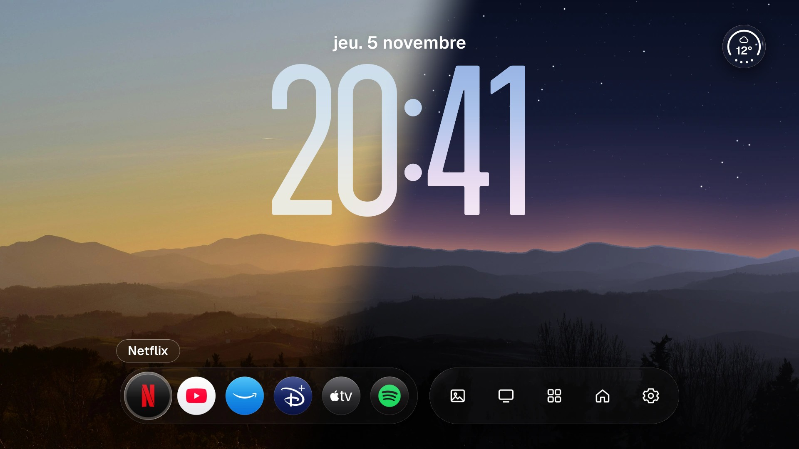
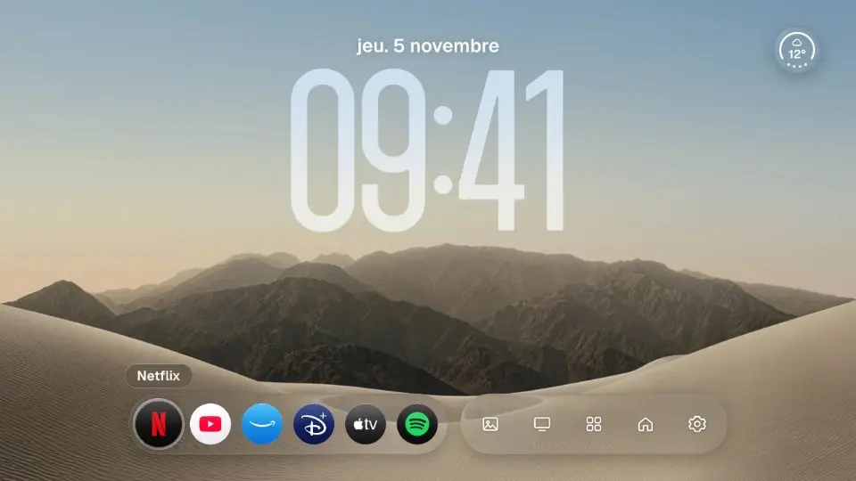
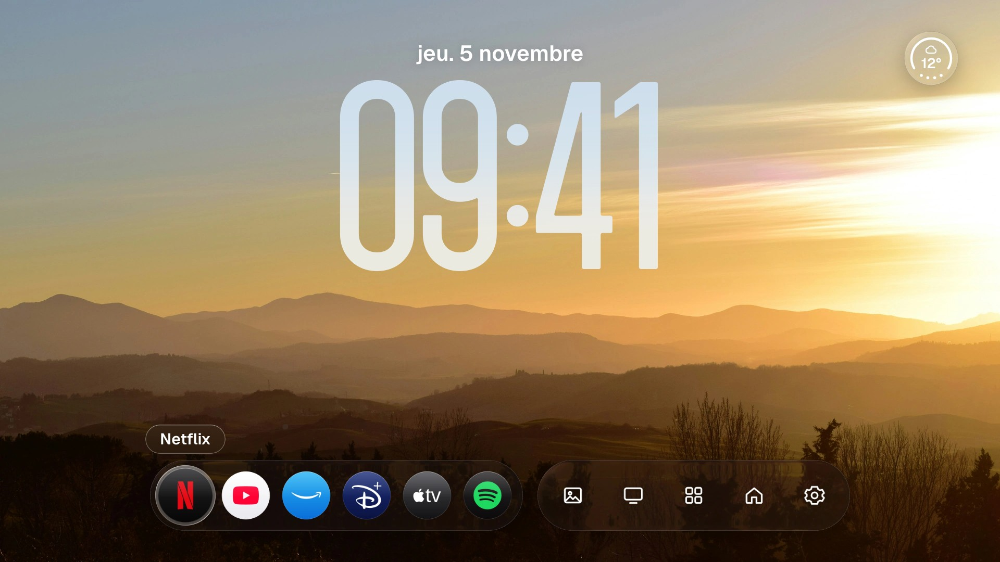
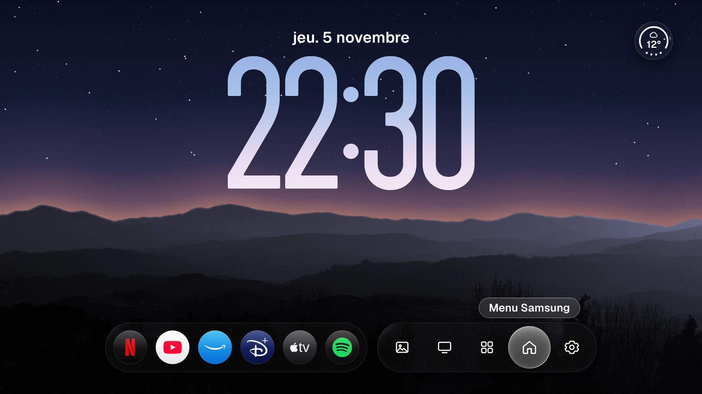
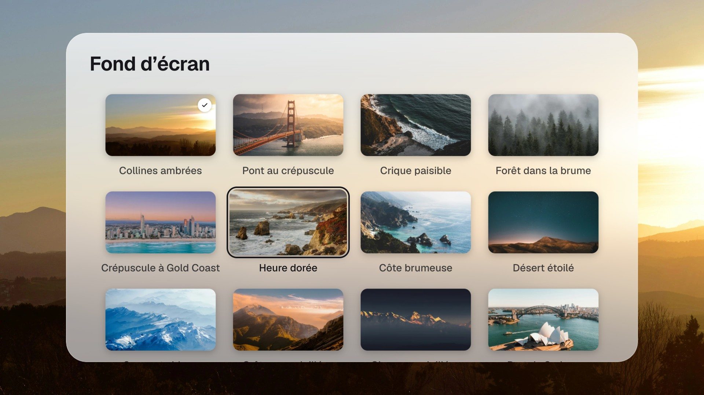
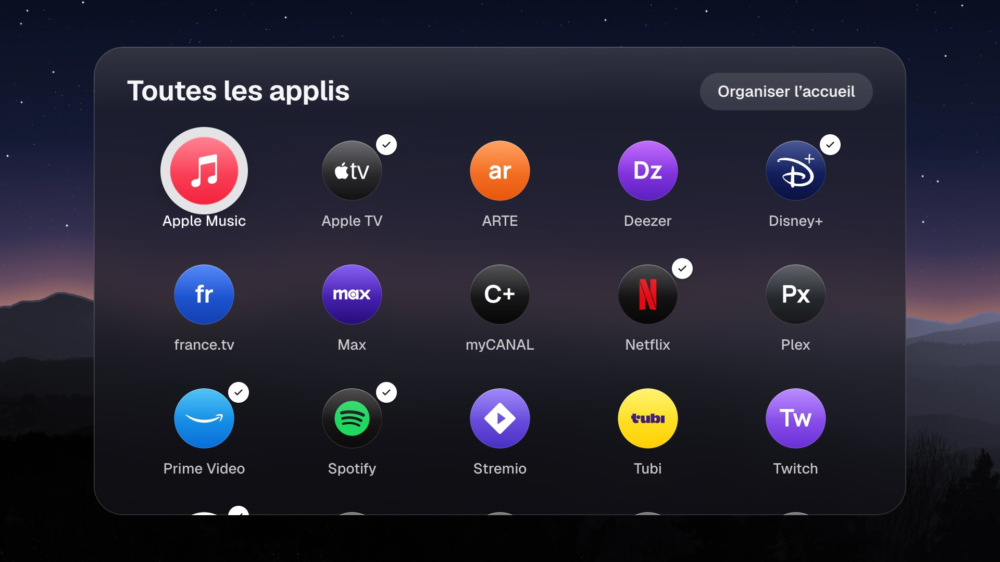
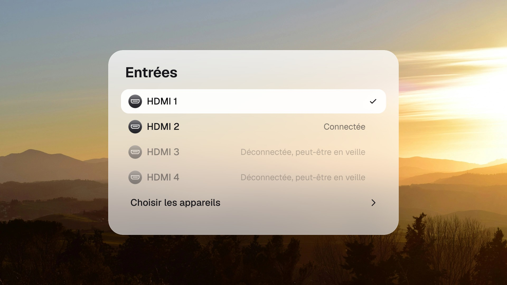
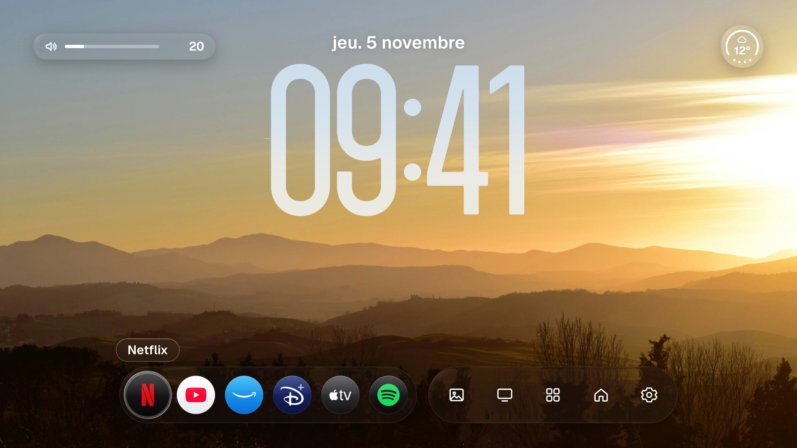
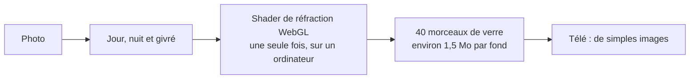

<p align="center">
  
</p>

<h1 align="center">CleanFrame TV</h1>

<p align="center">
  <strong>Un accueil en verre, pensé pour la télécommande, pour la Samsung The Frame.</strong><br>
  Liquid Glass, animations à ressort et un écran qui suit le soleil, sur un navigateur de télé de 2017.
</p>

<p align="center">
  <a href="https://shizub.github.io/cleanframe-tv/"><strong>Essayer la démo</strong></a> ·
  <a href="https://github.com/Shizub/cleanframe-tv/releases/latest">Télécharger</a> ·
  <a href="docs/duo-engineering.md">Comment ça marche</a> ·
  <a href="README.md">English</a>
</p>

<p align="center">
  <a href="https://github.com/Shizub/cleanframe-tv/actions/workflows/check.yml"></a>
  
  
  <a href="LICENSE"></a>
</p>

<p align="center">
  
</p>

L’accueil d’une Samsung Frame est chargé, et c’est la première chose qu’on voit sur une télé faite pour être accrochée comme un tableau. CleanFrame TV le remplace par quelque chose de proche d’un écran verrouillé de téléphone, inspiré de l’iPhone Duo : une grande horloge, un fond d’écran et une rangée de verre. Il est construit sur [CleanFrame](https://github.com/nthnclrk/CleanFrame), de Nathan Clark.

Il tourne sur ma Frame de 2018.

## Ce qu’il fait

<table>
  <tr>
    <td width="50%"><br><strong>Calme le jour.</strong> Une grande horloge, la date et la météo. Après 20 secondes, la rangée s’efface : il ne reste que l’image et l’heure.</td>
    <td width="50%"><br><strong>Suit le soleil.</strong> L’écran passe à la nuit selon la vraie hauteur du soleil, calculée hors ligne.</td>
  </tr>
  <tr>
    <td><br><strong>Le fond que tu veux.</strong> Choisis-en un dans la galerie, le verre change avec lui. <a href="#à-ton-image">Ajoute tes propres photos</a> en une commande.</td>
    <td><br><strong>Toutes les applis.</strong> Celles installées sur la télé, avec des icônes dessinées pour les plus connues, dans des cartes de verre givré.</td>
  </tr>
  <tr>
    <td><br><strong>Le HDMI dans la rangée.</strong> Une console se pose à côté des applis, avec son logo, et OK passe dessus.</td>
    <td><br><strong>Un son pour chaque geste.</strong> Huit styles, plus doux la nuit, et une pastille de volume en vrai verre calculé.</td>
  </tr>
</table>

Les dispositions d’origine, Liste et Barre, restent disponibles dans les réglages.

## À ton image

```sh
npm run duo:add -- ~/Images/photo.jpg --name "Mon fond"
```

Cette commande recadre la photo, calcule une version de nuit et rend chaque morceau de verre pour elle. Le résultat reste sur ton ordinateur, sauf si tu demandes le contraire. [Plus d’options](scripts/duo-pack/README.md).

## Comment ça marche

Une télé comme celle-ci ne peut pas se permettre de flou en direct : [trois grands dégradés peuvent la faire tomber de 59,5 à 4,6 images par seconde](https://github.com/NelsonEU/arn0-tv#what-the-hardware-can-afford). Il y a donc une règle : **la télé n’affiche que des images finies, et seuls `transform` et `opacity` changent.**



- **Liquid Glass calculé à l’avance :** un vrai shader de réfraction tourne une fois pour chaque forme que l’écran peut montrer.
- **Moteur de ressorts :** en ES5 et sans dépendance, résolu analytiquement et joué par le compositeur. Rien ne tourne au repos.
- **Moteur de son :** des sons synthétisés à volume perçu égal, avec des secours de Web Audio vers un élément audio, puis vers les bips de la télé.
- **Jour et nuit hors ligne :** la hauteur du soleil vient de formules astronomiques, testées contre des valeurs indépendantes.

[Lire le détail](docs/duo-engineering.md) (en anglais), y compris ce que la première installation sur une vraie télé a cassé.

## Testé

| Contrôle | Résultat |
| --- | --- |
| Duo, dans des navigateurs vierges avec une télé simulée | **500 contrôles** |
| Même série dans Chromium 85, le moteur des télés de 2022 | Réussie avant cette version, voir [les tests](docs/testing.md) |
| Dispositions Liste et Barre | **424 contrôles** |
| Performance | **40 contrôles** |
| Vraie Frame de 2018 (Tizen 4.0, Chromium 56) | Affichage, son, applis, Mode Art, entrées et menu Samsung confirmés à la main |

Les contrôles navigateur ne sont pas des mesures sur la télé, et les [notes de compatibilité](docs/compatibility.md) séparent les deux. Les temps d’image sur la télé restent à mesurer, et la galerie de fonds n’y a pas encore été essayée.

## L’essayer

**Dans ton navigateur :** ouvre la [démo en ligne](https://shizub.github.io/cleanframe-tv/), ou télécharge `CleanFrame-demo.zip` depuis la [dernière version](https://github.com/Shizub/cleanframe-tv/releases/latest), décompresse-le et ouvre `index.html`.

**Depuis le code**, avec Node.js 22.13+ et Python 3.10+ :

```sh
git clone https://github.com/Shizub/cleanframe-tv.git
cd cleanframe-tv
npm ci
npm run dev:public
```

Ouvre ensuite [localhost:4795/home/](http://localhost:4795/home/). Utilise les flèches, Entrée et Échap.

**Sur une télé :** une Samsung n’installe qu’un paquet signé avec ton propre certificat, donc le téléchargement n’est pas signé. Suis le [guide d’installation](docs/agent-tv-setup-guide.md) (en anglais), à tes risques.

## Ce que j’ai construit

CleanFrame, de Nathan Clark, a fourni le lanceur : la navigation à la télécommande, la découverte des applis, les préférences et les dispositions Liste et Barre. Ce dépôt ajoute :

- l’interface en français et la météo ;
- l’accueil Duo et ses cartes de verre ;
- la chaîne de calcul du verre et la galerie de fonds ;
- le moteur de ressorts et le moteur de son ;
- les sources HDMI dans la rangée, et une rangée synchronisée avec la télé ;
- le portage sur une Frame de 2018 et son ancien moteur de navigateur ;
- la série de contrôles Duo.

J’en ai fait la conception, pris les décisions et réalisé les essais sur le vrai matériel. Le code a été écrit avec [Claude Code](https://claude.com/claude-code), comme l’indiquent les commits.

## Crédits et licence

MIT, pour le code et la documentation du projet de Nathan Clark comme de celui-ci : voir [LICENSE](LICENSE). Les photos, polices et logos gardent leurs propres conditions, listées dans [THIRD_PARTY_NOTICES.md](THIRD_PARTY_NOTICES.md). Le verre est rendu avec [webgl-apple-liquid-glass](https://github.com/Oliverrr2424/webgl-apple-liquid-glass), d’Oliver Nemo.

Ce projet est indépendant, sans lien avec Samsung, Apple ou un service de streaming. Il ne contient aucune image d’Apple, et les chiffres de son horloge sont des dessins originaux.
