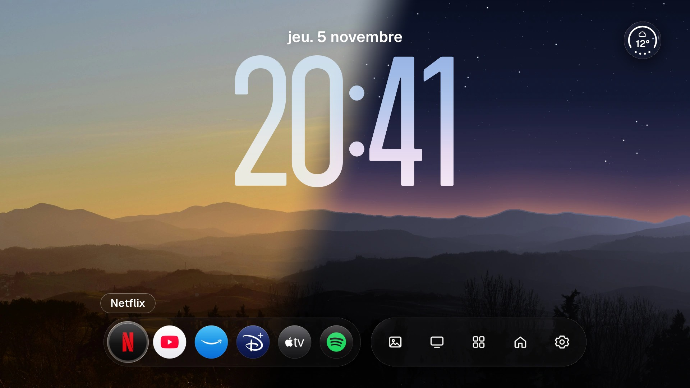
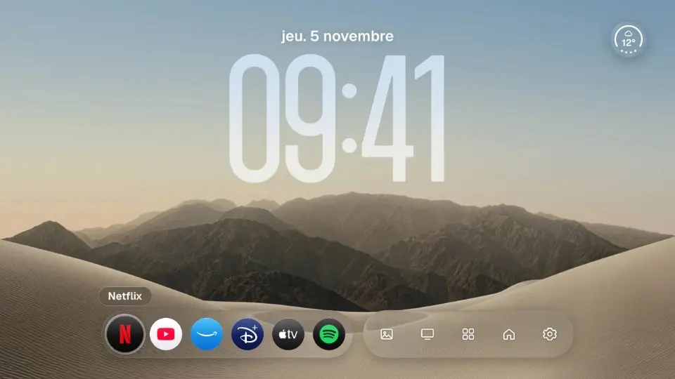
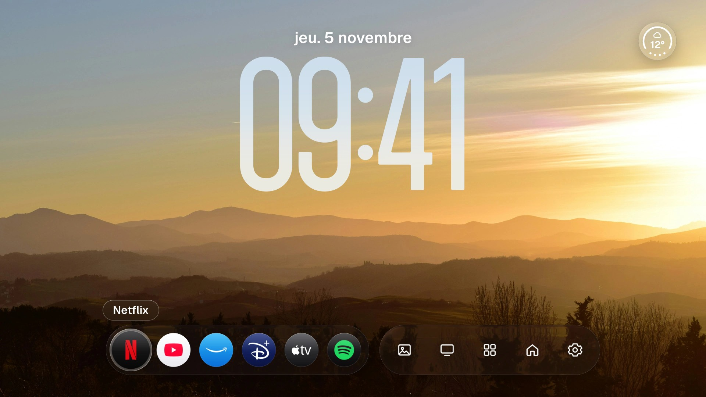
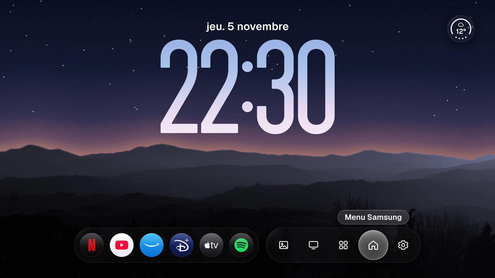
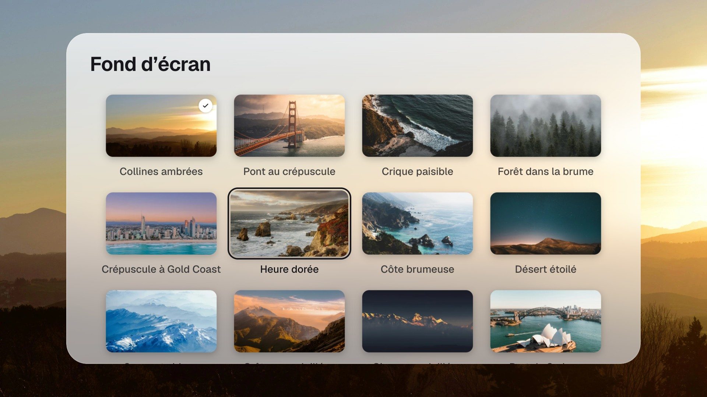
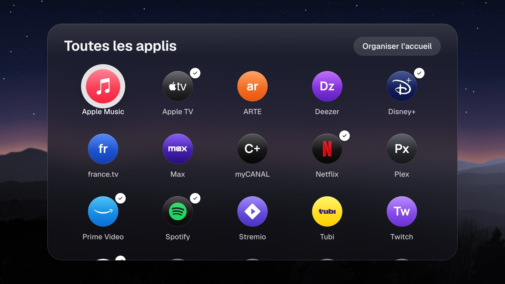
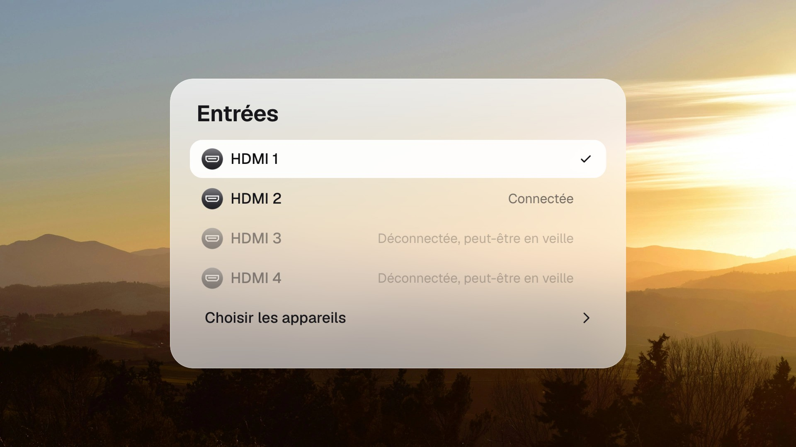
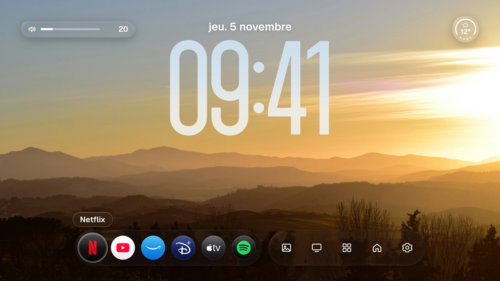
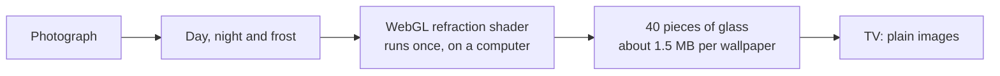

<p align="center">
  
</p>

<h1 align="center">CleanFrame TV</h1>

<p align="center">
  <strong>A glassy, remote-first home screen for Samsung The Frame.</strong><br>
  Liquid Glass, spring animations and a screen that follows the sun, on a TV browser from 2017.
</p>

<p align="center">
  <a href="https://shizub.github.io/cleanframe-tv/"><strong>Try the live demo</strong></a> ·
  <a href="https://github.com/Shizub/cleanframe-tv/releases/latest">Download</a> ·
  <a href="docs/duo-engineering.md">How it works</a> ·
  <a href="README.fr.md">Français</a>
</p>

<p align="center">
  <a href="https://github.com/Shizub/cleanframe-tv/actions/workflows/check.yml"></a>
  
  
  <a href="LICENSE"></a>
</p>

<p align="center">
  
</p>

The home screen of a Samsung Frame is busy, and it is the first thing you see on a TV that is meant to hang like a painting. CleanFrame TV replaces it with something closer to a phone's lock screen, inspired by the iPhone Duo: a tall clock, a wallpaper, and a row of glass. It is built on [CleanFrame](https://github.com/nthnclrk/CleanFrame) by Nathan Clark.

It runs on my own 2018 Frame.

## What it does

<table>
  <tr>
    <td width="50%"><br><strong>Calm by day.</strong> A tall clock, the date and the weather. After 20 seconds the row steps aside, and the screen is just the picture and the time.</td>
    <td width="50%"><br><strong>Follows the sun.</strong> The screen fades to night with the real altitude of the sun, computed offline.</td>
  </tr>
  <tr>
    <td><br><strong>Any wallpaper, at will.</strong> Pick one in the gallery, and the glass changes with it. <a href="#make-it-yours">Add your own photographs</a> with one command.</td>
    <td><br><strong>Every app.</strong> The TV's installed apps, with tiles baked for the known ones, in cards of frosted glass.</td>
  </tr>
  <tr>
    <td><br><strong>HDMI on the row.</strong> A console sits next to the apps, with its own logo, and OK switches to it.</td>
    <td><br><strong>A sound for each gesture.</strong> Eight styles, softer at night, and a volume pill made of real baked glass.</td>
  </tr>
</table>

The original List and Dock layouts remain available in Settings.

## Make it yours

```sh
npm run duo:add -- ~/Pictures/photo.jpg --name "My wallpaper"
```

That one command crops the photograph, computes a night version and renders every piece of glass for it. The result stays on your computer unless you ask otherwise. [More options](scripts/duo-pack/README.md).

## How it works

A TV like this cannot afford live blur: [three large gradients can take it from 59.5 to 4.6 frames per second](https://github.com/NelsonEU/arn0-tv#what-the-hardware-can-afford). So there is one rule: **the TV only shows finished images, and only `transform` and `opacity` ever change.**



- **Baked Liquid Glass:** a real refraction shader runs once for every shape the screen can show.
- **Spring engine:** an ES5 engine with no dependency, solved analytically and played by the compositor. Nothing runs at rest.
- **Sound engine:** synthesized sounds at matched loudness, with fallbacks from Web Audio to an audio element to the TV's own beeps.
- **Offline day and night:** solar altitude from astronomical formulas, tested against independent values.

[Read the full write-up](docs/duo-engineering.md), including what the first installation on a real TV broke.

## Tested

| Check | Result |
| --- | --- |
| Duo, in fresh browsers with a simulated TV | **500 checks** |
| Same suite in Chromium 85, the engine of 2022 TVs | Passed before this release, see [testing](docs/testing.md) |
| List and Dock layouts | **424 checks** |
| Performance | **40 checks** |
| Real 2018 Frame (Tizen 4.0, Chromium 56) | Display, sound, apps, Art Mode, inputs and Samsung's menu confirmed by hand |

Browser checks are not TV measurements, and the [compatibility notes](docs/compatibility.md) keep them apart. Frame times on a TV are still to be measured, and the wallpaper gallery has not been tried on a TV yet.

## Try it

**In your browser:** open the [live demo](https://shizub.github.io/cleanframe-tv/), or download `CleanFrame-demo.zip` from the [latest release](https://github.com/Shizub/cleanframe-tv/releases/latest), unzip it and open `index.html`.

**From the source**, with Node.js 22.13+ and Python 3.10+:

```sh
git clone https://github.com/Shizub/cleanframe-tv.git
cd cleanframe-tv
npm ci
npm run dev:public
```

Then open [localhost:4795/home/](http://localhost:4795/home/). Use the arrows, Enter and Escape.

**On a TV:** a Samsung TV only installs a package signed with your own certificate, so the download is unsigned. Follow the [setup guide](docs/agent-tv-setup-guide.md), and use it at your own risk.

## What I built

CleanFrame by Nathan Clark provided the launcher: remote navigation, app discovery, preferences and the List and Dock layouts. This repository adds:

- the French interface and the weather;
- the Duo home screen and its cards of glass;
- the baked glass pipeline and the wallpaper gallery;
- the spring engine and the sound engine;
- HDMI sources on the row, and a row that stays in step with the TV;
- the port to a 2018 Frame and its older browser engine;
- the Duo test suite.

I designed it, made the decisions and tested it on real hardware. The code was written with [Claude Code](https://claude.com/claude-code), as the commits record.

## Credits and licence

MIT, for the code and documentation of both Nathan Clark's project and this one: see [LICENSE](LICENSE). Photographs, fonts and logos keep their own terms, listed in [THIRD_PARTY_NOTICES.md](THIRD_PARTY_NOTICES.md). The glass is rendered with [webgl-apple-liquid-glass](https://github.com/Oliverrr2424/webgl-apple-liquid-glass) by Oliver Nemo.

This is an independent project, not affiliated with Samsung, Apple or any streaming service. It contains no Apple imagery, and its clock digits are original drawings.
