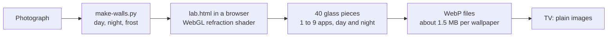

# How the Duo home screen works

Duo looks like live Liquid Glass. It runs on a television whose browser engine dates from 2017, and it costs that television almost nothing. This page explains how.

## The constraint

A Samsung Frame runs web apps on an old Chromium and a modest chip: Chromium 56 on a 2018 model, Chromium 85 on a 2022 one. [Measurements on the same class of TV](https://github.com/NelsonEU/arn0-tv#what-the-hardware-can-afford) saw three large gradients take the screen from 59.5 to 4.6 frames per second. Live `backdrop-filter`, WebGL and `linear()` easing are out.

So there is one rule: **the TV only shows finished images, and only `transform` and `opacity` ever change.** Everything expensive happens beforehand, on a computer.

## Glass, baked once

A real refraction shader runs for every shape the screen can show, by day and by night, against the exact pixels behind it. Each result is flattened with its soft shadow into one image. The price is that light does not react continuously and shapes do not merge like liquid. On a still screen, nobody can tell.

Because glass depends on what is behind it, each wallpaper has its own set. `npm run duo:add` turns any photograph into a complete set, and the [gallery](interaction-behaviour.md) only loads the chosen one.

## Frost that slides

What moves cannot be baked in place, so it uses frost: a blurred copy of the wallpaper inside a clipped element. As the element moves one way, the image inside it moves exactly the other way, so the blur stays aligned with the scene. It costs two transforms.

The name pill under the selection, every settings card and the volume pill all work this way. The 2018 engine needs one extra step: it only reads `-webkit-clip-path` and does not clip a layer that is moving, so these elements also clip with rounded overflow.

## Springs without a dependency

[`app/motion.js`](../app/motion.js) is a small ES5 spring engine using Apple's duration-and-bounce model. A move is solved analytically, then sampled once into Web Animations keyframes, so the compositor plays it and nothing runs at rest. A spring bends most at its start, so the keyframes crowd there: 14 follow it as closely as 28 evenly spaced ones, and small moves use 8. Interrupting a move continues from its current position and speed.

| Element | Duration | Bounce |
| --- | --- | --- |
| Sliding selection | 0.32 s | 0.12 |
| Focused icon | 0.35 s | 0.25 |
| Icon losing focus | 0.28 s | 0 |
| Press on OK | 0.30 s | 0.20 |
| Panel entering | 0.50 s | 0.15 |
| Panel leaving | 0.35 s | 0 |
| Clock digit | 0.45 s | 0 |

## Day and night, from the sun

The screen follows the real altitude of the sun, computed offline from low-precision astronomical formulas and tested against independent values. Every baked image exists in a day and a night version, and dusk only changes the opacity of the night layer.

## Sound

[`app/sound.js`](../app/sound.js) gives each gesture its own short sound, in eight styles. Seven are synthesized by [`scripts/make-sounds.py`](../scripts/make-sounds.py) with no recording, and one comes from a CC0 pack, all at matched loudness.

- A key never waits for a sound. One that is not ready stays silent.
- Held keys do not rattle: the clicks space out and soften.
- At night, sounds are quieter and less bright.
- The engine falls back from Web Audio to an `<audio>` element, then to the TV's own beeps. The 2018 TV needed those fallbacks: its engine has no `AudioBuffer` constructor and no stereo panner.

## Arriving whole

A home screen that assembles itself piece by piece looks broken. At startup the launcher stays hidden until its wallpapers, glass and font are ready, for 2.5 seconds at most, then fades in as one. Filming the startup frame by frame found the wallpaper landing 100 to 130 ms after everything else, two times out of three. The launcher had been waiting for placeholder images. The check now fails if either old behaviour comes back, and that was verified by putting each one back.

The same principle applies to the gallery: a new wallpaper, its glass and its frost are all loaded first, then change in a single frame.

## What a real TV taught

Everything was built against a simulated TV first. Then it was installed on a 2018 Frame:

- The pill's frost covered the whole screen, because of the clip-path limit above.
- There was no sound at all, because of the missing audio constructors.
- Netflix appeared twice, and Prime Video and CANAL+ were hidden, because that TV lists them under other IDs and a filter was hiding anything with "Launcher" in its ID.
- YouTube opened without the signed-in account, because the TV has two YouTube apps, and the tile opened the wrong one.

Each is fixed and covered by a check. [`docs/compatibility.md`](compatibility.md) records what is confirmed, and what is still open.

## How it is tested

`npm run check:duo` drives the real app in fresh browsers with a simulated Tizen API: the layout for one to nine apps, 720p, every panel, the sounds at the audio output, the fallbacks, memory across repeated panels, key latency under a 4× CPU slowdown, and the packaged app opened from its own files. It also runs in Chromium 85. These checks describe a browser, not a TV, and the documents here keep the two apart.
